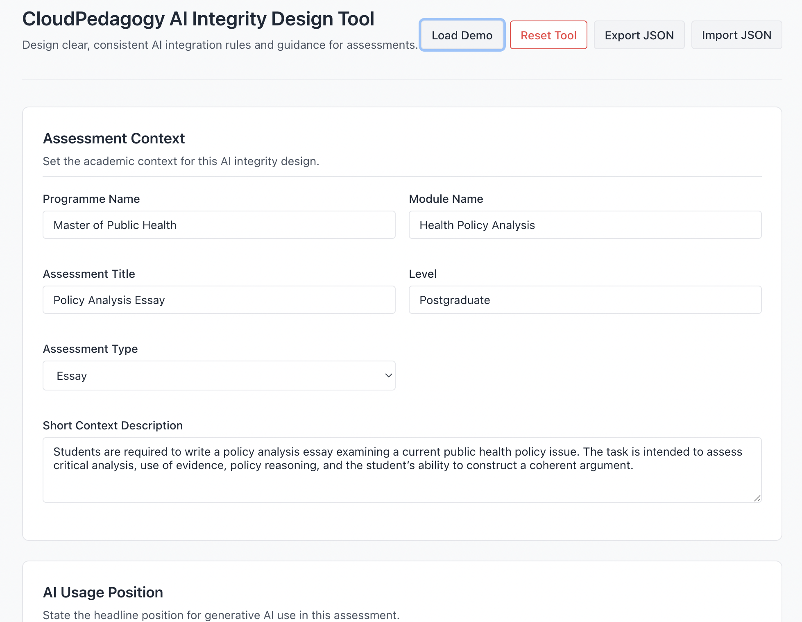

# AI Integrity Design Tool

A local-first tool for designing clear, structured, and governance-ready approaches to acceptable AI use in assessment.

🌐 **Live Hosted Version**  
http://cloudpedagogy-ai-integrity-design-tool.s3-website.eu-west-2.amazonaws.com/

🖼️ **Screenshot**  


---

## 🔗 Role in the CloudPedagogy Ecosystem

**Phase:** Phase 4 — Assessment & Integrity Layer  

**Role:**  
Supports the design of AI-aware academic integrity approaches by defining acceptable use, conditions, risks, and guidance for both students and staff.

**Upstream Inputs:**  
- Assessment structures from the Assessment Design Engine  
- Institutional policy context (optional)

**Downstream Outputs:**  
- Structured guidance for the Evidence & QA Pack Generator  
- Inputs for Curriculum Change Manager (tracking policy evolution)

**Does NOT:**  
- Detect or police misconduct  
- Replace institutional policy frameworks  
- Automatically generate compliance decisions  

---

## Additional Documentation

- [User Instructions](./INSTRUCTIONS.md)
- [Project Specification](./PROJECT_SPEC.md)

---

## Overview

The **AI Integrity Design Tool** supports a shift from reactive enforcement to **integrity-by-design**.

It enables educators and programme teams to:
- Define acceptable, unacceptable, and conditional AI use  
- Generate clear student-facing guidance  
- Document staff rationale and authenticity expectations  
- Identify risks and assumptions in AI-enabled assessment  

This helps create assessment environments that are:
- transparent  
- consistent  
- pedagogically aligned  
- governance-aware  

---

## Key Features

- **AI Usage Positioning**  
  Define whether AI use is allowed, restricted, or conditional  

- **Structured Use Definitions**  
  Specify acceptable and unacceptable uses  

- **Conditions & Constraints**  
  Capture boundaries for appropriate AI use  

- **Guidance Generation**  
  Produce student-facing guidance and staff rationale  

- **Risk & Authenticity Design**  
  Identify risks and authenticity considerations  

---

## Technical Overview

- Built with TypeScript + Vite (React 19)  
- Fully local-first — runs entirely client-side in the browser  
- Configured with relative asset paths (`base: './'`) for standalone deployment or embedding within iframe / subfolder contexts (e.g. Assessment & Integrity Studio)
- Non-destructive state persistence in `localStorage` (`cp-ai-integrity-state`) with recovery backup protection (`cp-ai-integrity-state-corrupted-backup`)
- Safe structural JSON import validation and Blob-based JSON export (`URL.createObjectURL`)
- Clean Print / Save to PDF output with dedicated media print stylesheet (`@media print`)
- Comprehensive automated regression testing suite using Vitest and React Testing Library
- No external runtime dependencies, tracking, telemetry, or backend storage  

---

## Development & Testing

### Installation

```bash
npm install
```

### Run Locally (Dev Server)

```bash
npm run dev
```

### Run Automated Tests

```bash
# Run full regression test suite (72+ tests)
npm test

# Run tests in watch mode
npm run test:watch
```

### Run Linter

```bash
npm run lint
```

### Production Build

```bash
npm run build
```

Build outputs are generated in `dist/` with relative asset links (`./assets/...` and `./favicon.svg`), ready for static hosting or local file serving without root-path dependencies.

---

## State Persistence & Data Integrity

- **Primary Storage Key:** `cp-ai-integrity-state`
- **Corrupted Data Backup Key:** `cp-ai-integrity-state-corrupted-backup`
- **Non-Destructive Parsing:** If `localStorage` contains invalid, unrecognized, or corrupted data, the application never silently overwrites it. A backup is safely stored under the backup key, an empty workspace is loaded, and the original invalid data is preserved for manual recovery.
- **JSON Import Validation:** Structural validation checks schema compatibility, rejects malformed payloads with clear error messages, and preserves the currently active workspace if an import fails.
- **Export Reliability:** Exports are generated as standard UTF-8 JSON files using client-side Blob URLs with automatic resource cleanup.

---

## Print & PDF Export

- Access via the **Print / Save to PDF** button in the header or the Guidance Summary section, or using standard browser shortcuts (`Ctrl+P` / `Cmd+P`).
- Form controls, action buttons, starter chips, navigation elements, and the live status region are hidden in print mode (`.cp-hide-print`).
- The printable summary formats assessment context, AI stance, acceptable/unacceptable lists, caveats, rationale, and institutional policy references cleanly without clipped margins or nested scrollbars.

---

## Operational Limitations

- **Browser-Side Storage Quotas:** State persistence is subject to the client browser's origin `localStorage` quota (typically 5MB).
- **Client-Side Print / PDF:** PDF generation relies on the native browser print engine ("Save as PDF"); formatting may vary slightly across different PDF rasterizers and printer drivers.
- **Clipboard Permissions:** In environments where `navigator.clipboard` is restricted or unavailable (e.g. non-HTTPS iframes), the application automatically attempts an `execCommand` fallback.

## Design Principles

- Local-first and inspectable  
- Governance-aware by design  
- Structured, not automated decision-making  
- Supports human judgement rather than replacing it  

---

## Disclaimer

This repository contains exploratory, framework-aligned tools developed for reflection, learning, and discussion.

These tools are provided as-is and are not production systems, audits, or compliance instruments. Outputs are indicative only and should be interpreted using professional judgement.

- All applications run locally in the browser  
- No user data is collected, stored, or transmitted  
- All example data is synthetic and does not represent real institutions or programmes  

---

## Capability and Governance

This tool supports both AI capability development and lightweight governance.

- Capability is developed through structured interaction with real workflows
- Governance is supported through optional fields that make assumptions, risks, and decisions visible

All governance inputs are optional and designed to support — not constrain — professional judgement.

---

## About CloudPedagogy

CloudPedagogy develops open, governance-credible tools for building confident, responsible AI capability across education, research, and public service.

- Website: https://www.cloudpedagogy.com/  
- Framework: https://github.com/cloudpedagogy/cloudpedagogy-ai-capability-framework  
